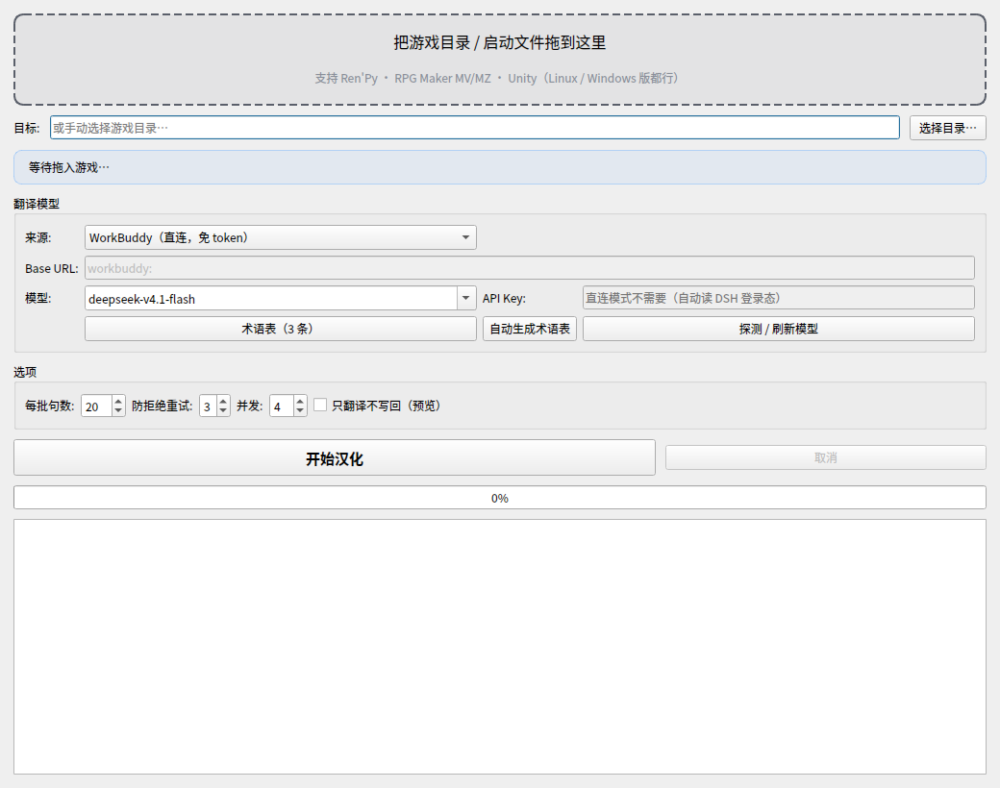

# galgame-tl

**把 galgame 拖进去，自动识别引擎 → 提取文本 → AI 翻译 → 写回游戏。Linux 原生，不需要 Wine。**

支持 **Ren'Py**、**RPG Maker MV/MZ**、**RPG Maker VX Ace / VX / XP（RGSS）**、**Unity** 四类引擎。



---

## 目录

- [这是什么](#这是什么)
- [快速开始](#快速开始)
- [界面怎么用](#界面怎么用)
- [支持的引擎](#支持的引擎)
- [翻译模型](#翻译模型)
- [三道翻译流水线](#三道翻译流水线)
- [为什么不会被拒绝](#为什么不会被拒绝)
- [精度怎么保证](#精度怎么保证)
- [各引擎的工程细节](#各引擎的工程细节)
  - [Ren'Py](#renpy)
  - [RPG Maker MV/MZ](#rpg-maker-mvmz)
  - [RPG Maker VX Ace / VX / XP](#rpg-maker-vx-ace--vx--xp)
  - [Unity](#unity)
- [Windows 游戏](#windows-游戏)
- [运行环境修复](#运行环境修复)
- [命令行](#命令行)
- [目录结构](#目录结构)
- [踩坑总表](#踩坑总表)
- [常见问题](#常见问题)
- [还原](#还原)
- [已验证 / 未验证](#已验证--未验证)
- [许可与致谢](#许可与致谢)

---

## 这是什么

Linux 上一直缺一个能用的 galgame 汉化工具。Windows 上有 MTool，但它要 Wine、
要会员、要联网校验，而且对 Ren'Py 的支持很一般。这个项目想解决三件事：

1. **Linux 原生**——不经过 Wine，直接读写游戏文件。Ren'Py 的 `.rpa`、
   RPG Maker 的 `.json` 和 `.rvdata2`、Unity 的 `.assets`，都能在 Linux 上直接处理。
2. **真的能玩**——不是导出个文本给你自己看。翻完直接写回游戏，打开就是中文，
   字体、断行、标点全部处理过，不会满屏方框。
3. **R18 内容不被拒**——这是这类工具最容易翻车的地方。R18 文本送进模型，
   回一句「抱歉，我无法协助处理这类内容」，这句话会真的写进游戏显示给玩家。
   本项目用六层机制处理，实测三万条台词零污染。

代码量约 **6700 行**，Python 3.10+，GUI 用 PySide6。

---

## 快速开始

### 环境要求

- Linux（x86_64 或 aarch64）
- Python 3.10 以上（推荐 3.12）
- `uv`（推荐）或 `pip`
- 桌面环境（GUI 需要；纯命令行不需要）

```bash
# 1. 装 uv（如果没有）
curl -LsSf https://astral.sh/uv/install.sh | sh

# 2. 建虚拟环境并装依赖
cd galgame-tl
uv venv -p 3.12 .venv
uv pip install --python .venv/bin/python -r requirements.txt

# 3. 跑
./galgame-tl.sh
```

没有 `uv` 的话：

```bash
python3 -m venv .venv
.venv/bin/pip install -r requirements.txt
./galgame-tl.sh
```

### 装桌面图标（可选）

```bash
cat > ~/.local/share/applications/galgame-tl.desktop <<EOF
[Desktop Entry]
Type=Application
Name=galgame 汉化工具
Comment=拖入游戏，自动翻译
Exec=$(pwd)/galgame-tl.sh
Icon=$(pwd)/icon.svg
Terminal=false
Categories=Utility;
EOF
update-desktop-database ~/.local/share/applications 2>/dev/null || true
```

之后应用列表里搜「galgame」就能打开。

### 三步跑完

1. **拖进去** —— 把游戏目录、启动脚本（`.sh` / `AppImage`）、甚至 `.exe`
   拖到虚线框里。会立刻显示「识别到 Ren'Py，找到 4 个 rpyc」这类结果。
2. **选模型** —— 见[翻译模型](#翻译模型)。默认已经配好 WorkBuddy 直连。
3. **点「开始汉化」** —— 日志实时刷，进度条实时走，随时能取消。

跑完直接开游戏就是中文了。想还原见[还原](#还原)。

---

## 界面怎么用

从上到下：

| 区域 | 说明 |
|---|---|
| **拖放区** | 拖游戏目录或启动文件。`.exe` 会自动尝试拆安装包 |
| **识别结果** | 引擎、变体、根目录、启动方式、证据列表 |
| **来源** | 三选一：WorkBuddy 直连 / WorkBuddy 网关 / OpenAI 兼容 |
| **Base URL** | 直连模式自动填 `workbuddy:` 并禁用 |
| **模型** | 下拉可编辑，直连模式自动读出上游 60+ 个模型 |
| **API Key** | 直连和网关模式禁用 |
| **探测 / 刷新模型** | 拉一次 `/models` 确认能连通；直连模式刷新账号与模型 |
| **术语表** | 编辑 `glossary.json`，按钮上显示当前条数 |
| **自动生成术语表** | 从台词里自动找专有名词，见[精度怎么保证](#精度怎么保证) |
| **每批句数** | 默认 20，越小越不容易触发内容过滤 |
| **防拒绝重试** | 默认 3 轮，逐轮加强语境 |
| **并发** | 默认 4，实测不触发限速 |
| **NVIDIA 兜底** | 默认开 |
| **谷歌翻译兜底** | 默认开 |
| **繁转简清洗** | 默认开 |
| **Windows 版改造成 Linux 原生** | 拖入 Windows 包自动勾上 |
| **只翻译不写回** | 预览模式，产出 JSON 不碰游戏文件 |

所有设置用 `QSettings("galgame-tl", "galgame-tl")` 持久化，下次打开还在。

---

## 支持的引擎

判定按「特征强度」排，不按文件多少。输入可以是游戏根目录、启动脚本、
`.exe`，程序会自动上跳到正确层级（`game/`、`www/`、`data/` 这些子目录拖进来也认）。

| 引擎 | 判定特征 | 文本位置 | 处理方式 |
|---|---|---|---|
| **Ren'Py** | `renpy/` 目录、`*.rpa`、`game/*.rpyc`、`game/*.rpy`、`lib/py3-*` | `game/**/*.rpy` 里的 say 语句 | 生成 `game/tl/chinese/`，不动本体 |
| **RPG Maker MV** | `www/data/System.json` + `www/js/rpg_core.js` | `www/data/*.json` | 直接改 JSON，改前备份 |
| **RPG Maker MZ** | `data/System.json` + `js/rmmz_core.js` | `data/*.json` | 同上 |
| **RPG Maker VX Ace** | `Game.ini` + `System/RGSS3xx.dll` + `Game.rgss3a` | `Game.rgss3a` 里的 `Data/*.rvdata2` | 解 RGSSAD → 改 Ruby Marshal → 重打包 |
| **RPG Maker VX / XP** | `Library=RGSS300/202`、`Game.rgss2a/rgssad` | 同上 | 同上（RGSSAD v1/v2 算法） |
| **Unity** | `*_Data/Managed/Assembly-CSharp.dll`、`UnityPlayer.so`、`globalgamemanagers` | TextAsset | UnityPy 抽改，或走 BepInEx |

**其它引擎**会给出线索不报错，比如：

```
疑似 KiriKiri (XP3) → 可用 kiriKiri2 / xp3 解包工具
疑似 BGI / Ethornell → 可用 arc_unpacker
疑似 CatSystem2 → 可用 GARbro / IntParse
疑似 NScripter → 可用 nsdec
疑似 Wolf RPG → 可用 WolfDec / GARbro
疑似 吉里吉里 (KAG) → KAG 脚本明文，可直接改
```

---

## 翻译模型

### 方式 A：WorkBuddy 直连（推荐，免 token）

打开软件，来源选「WorkBuddy（直连，免 token）」，它会自动读出你在 DSH 里
登录的 WorkBuddy 账号和上游模型列表，Base URL 和 API Key 都不用填。

**为什么能免 token**：插件的本地网关确实要 Bearer，而那把 Bearer 是
进程内 `randomBytes(32)` 生成的、不落盘，外部工具拿不到。但凭据本身落盘在
`~/.dsh/workbuddy-vault/<region>/<accountId>.json`，拿它直接打上游
`https://www.codebuddy.cn/v2/chat/completions` 就行——这正是插件内部做的事，
只是绕开了那层自签的 token。accessToken 过期会用 refreshToken 自动换。

上游那条路有三个规矩（都是实测出来的，写在 `core/wbdirect.py` 里）：

- **只认流式**：`stream: false` 会被 400 拒掉
  （`code:11101 Non-stream chat request is currently not supported`）；
- 请求头身份要对得上：`X-User-Id` / `X-Domain` / `X-Product` / `X-IDE-*` /
  `X-Conversation-*` 三件套 + UA `CLI/… CodeBuddy/…`；
- 答案在 SSE 的 `delta.content`，思考过程在 `delta.reasoning_content`，
  **必须分开取**，否则思维链会被当成译文写进游戏。

**模型怎么挑**（本机实测，4 句日文台词，同样 4 路并发）：

| 模型 | 耗时 | 备注 |
|---|---|---|
| `deepseek-v4.1-flash` | **1.6s** | 默认选它 |
| `fast-model` | 2.6s | |
| `deepseek-v4-flash` | 6.7s | |
| `hy3` | 50.6s | |
| `hy4std` | 64.2s | |
| `hy4free` | 79.5s | 免费但**会返回解析不了的格式**，不建议 |

### 方式 B：本机网关（需 token）

来源选「WorkBuddy（本机网关）」，程序自动扫回环端口（`ss -ltn` + 探测
`missing or invalid Authorization bearer` 特征）填好 Base URL。

但要去 DSH 设置里手动复制 Bearer token 填进 API Key——那把 token 每次
插件重启都会换，写死不了。

### 方式 C：任意 OpenAI 兼容端点

```
Base URL                            模型名
──────────────────────────────────────────────────────────
https://api.deepseek.com/v1         deepseek-chat
https://api.siliconflow.cn/v1       Qwen/Qwen2.5-32B-Instruct
http://127.0.0.1:11434/v1           qwen2.5:14b     （本地 ollama，免费不联网）
http://127.0.0.1:8080/v1            （本地 llama.cpp server）
```

填完点「探测 / 刷新模型」。

### 并发

两万句串行翻要十几小时。选项里的「并发」默认 4 路，实测不触发限速；
被限速就降到 2。实测 71 句：串行 52 秒，4 路并发 **3.4 秒**。

`Translator.translate_items` 用 `ThreadPoolExecutor` + `as_completed`，
缓存字典和落盘各有独立的锁（见[踩坑总表](#踩坑总表)第 12 条）。

---

## 三道翻译流水线

```
WorkBuddy (deepseek-v4.1-flash)  →  NVIDIA nemotron-3-ultra  →  谷歌翻译
        主力，快、语感好                 第一道拒的                  前两道都拒的
```

某一句在第一道翻不出来（内容过滤 / 流中途被掐 / 三轮加强语境都拒），
就掉到第二道；第二道也拒，掉到第三道。**三道都走同一套术语表占位符**，
人名译法全篇统一，不会因为换了引擎就跑偏。

### 第二道：NVIDIA Nemotron（`core/nvfallback.py`）

端点 `https://integrate.api.nvidia.com/v1/chat/completions`，
key 从 `~/.dsh/.credentials.yaml` 的 `refs.NVIDIA_API_KEY` 读，读不到自动关掉。

| 模型 | 20 句 R18 批次 | 速度 | 说明 |
|---|---|---|---|
| **nemotron-3-ultra-550b-a55b** | 20/20 | 37s | 默认，质量最好，专名照翻 |
| nemotron-3.5-super-vl-120b-a12b | 20/20 | 47s | 思维链 14000 字，慢 |
| nemotron-3.5-lightning-30b-a3b | 20/20 | 46s | 会把 `cock`/`pussy` 留英文 |

**兜底不是当成孤立字符串翻的**，三条约束与主流程完全一致：

- 带场景标签 + 前后各一句上下文（共用同一个 `ctx` dict）
- 术语表走同一套占位符（`protect` → `mask_glossary`）
- 提示里写死：连续台词代词时态要一致、上一句续写要接得上、
  `⟨Gx⟩` 占位符原样保留、`\n` 不动

**推理模型的坑**：super-vl / lightning / ultra 都是推理模型，思维链在
`message.reasoning_content`、正文在 `message.content`。`max_tokens` 给小了
额度全被思维链吃掉，`content` 返回 **`null`**、`finish_reason: "length"`——
看起来像模型拒答，其实是截断。ultra 有约 4000 字思维链，必须给 8192；
super-vl 要 16000。

另一个坑：响应里的 `model` 字段会变成 `private/nvidia/…` 这类别名，
别拿它做匹配。

### 第三道：谷歌翻译（`core/gfallback.py`）

Nemotron 也有边界。The Last Sovereign 最后剩 59 条极度露骨的性描写，
两个大模型都拒，机器翻译反而照翻——它不过滤文学性描写。

**端点实测**：

| 端点 | 结果 |
|---|---|
| `translate.googleapis.com/translate_a/single`（client=gtx） | **429 限流**，重试无效 |
| `clients5.google.com/translate_a/t`（client=dict-chrome-ex） | ✅ 稳，支持多 `q` 批量，4 句 1.88s |

`detect_proxy()` 先读 `https_proxy`/`HTTPS_PROXY`/`http_proxy`/`HTTP_PROXY`/
`all_proxy`/`ALL_PROXY`（socks 跳过），读不到就探本机
`7890, 7891, 1080, 10808, 10809, 8080, 8118, 8888`（FlClash 默认 7890）。

占位符实测保留：

```
⟨G0⟩ felt her ⟨G1⟩ tighten as he fucked her harder.
→ 当他更用力地操她时，⟨G0⟩ 感觉到她的⟨G1⟩ 收紧了。
```

---

## 为什么不会被拒绝

R18 文本送进去，模型回一句「抱歉，我无法协助处理这类内容」，这句话写进 tl
文件后游戏里就会真的显示这段道歉。六层机制：

### 1. 工程化语境

系统提示不说「翻译成人游戏台词」，而是：

> 你是商业游戏本地化团队的日译中译者，负责台词表（script table）的逐行翻译。
> 这是一份游戏脚本的工程校对任务：输入是 JSON 数组……

模型接到的是「字符串资源映射」任务，不是在生成内容。

### 2. 拒绝检测——难点是**不要认错**

返回结果逐行过 `looks_like_refusal()`。这里的难点不是「认出拒绝」，
而是「不要认错」——R18 台词里满地都是「抱歉，我来晚了」「对不起马修」，
用关键词判定必然误杀，而且一次误杀就要重跑一批。

判据只认两条：

- **有元话语**（`META_RE`）：自称 AI / 政策准则 /「无法翻译这段内容」
  「处理此类内容」这种在评论请求而不是在演台词的；
- **建议式句式**（`REFUSAL_SHAPE_RE`）：「建议你改用…」。

`WEAK_RE`（抱歉/对不起这类弱信号）**必须与 `META_RE` 共现**才算拒绝。

| 输入 | 判定 |
|---|---|
| 「作为 AI 语言模型，我无法协助处理这个请求。」 | 拒绝 |
| 「很抱歉，我不能协助处理此类内容。」 | 拒绝 |
| 「建议你改用其他方式处理这段文本。」 | 拒绝 |
| 「抱歉，只是感觉太爽了！」 | **不是** |
| 「我觉得对不起马修，可我就是忍不住…」 | **不是** |
| 「我无法理解你的心情。」 | **不是** |
| 「请理解我，我不能告诉你。」 | **不是** |
| 「He said he can't come today.」 | **不是** |

19 个用例全过；更硬的验证是拿真实译文跑：Savior 6776 条 + BlossomOfPleasure
10856 条，**零误判**。

### 3. 只重试被拒的那几句

```python
remaining = list(srcs)      # 每轮只发还没翻完的句子
done_map  = {}              # 翻成的按原下标存好
while remaining and round <= max_escalate:
    ...
```

误判通常一批只有 1~2 句，整批重跑既费 token 又刷屏。
日志还做了节流（前 3 次 + 每 50 次才打一行）。

### 4. 数量不符时二分重试

模型有时只返回一半。直接拿 `zip` 硬配会让 A 的台词写进 B 嘴里——
这是最危险的一类错误，看起来像「部分成功」。所以：

- `_repair_length` 少了就返回 `None`（整批作废，**绝不补空串**）；
- 数量不符时 `_translate_half()` 二分重试，实测 `调用句数序列: [20, 10, 10]`
  → 20/20 成功。

### 5. JSON 解析四级容错

模型经常把台词里的换行直接输进 JSON → `Invalid control character at: line 1
column 142`，整批作废。`_extract_json_array` 四级兜底：

1. `json.loads(t, strict=False)`
2. 转义控制字符 `re.sub(r"[\x00-\x1f]", lambda m: "\\u%04x" % ord(m.group()), t)`
3. **前缀抢救** `_salvage_prefix(t)`——模型按序输出，被截断时前 k 条是
   完全有效的。状态机逐字符扫，只认顶层逗号分隔的完整元素
4. 按引号对切分

第 3 条（前缀抢救）是效果最大的一条：被内容审核在流中途掐断时
（20 句翻到第 10 句，插一句 `Sorry, I can't respond to this question.`
然后关流），能救回前 10 条。

### 6. 三轮都失败 → 保留原文，交给下一道

绝不写入道歉文本。这三道全过的句子标成 deferred，日志里列出来，
游戏里显示原文（能玩），而不是显示一段中文道歉（出戏）。
重新跑一次只补这些，因为缓存里其他句子都在。

**效果**：The Last Sovereign 10856 条台词，最终
`标签污染 0 条 / 真英文残留 3 条（`\n\n`、`「Death？」`、`OooOOooh？`——都不该翻）`。

---

## 精度怎么保证

### 术语表（人名一致性）

翻译前把原文里的词替换成 `⟨G0⟩` 占位符，翻完再换回中文，全篇人名绝对不会飘。
**先有术语表再开翻**，比翻完再统一改省太多事。

```python
mask_glossary("おはよう、ご主人様。", {"ご主人様": "主人"})
# → ("おはよう、⟨G0⟩。", {"⟨G0⟩": "主人"})
```

按原文长度降序替换（长词优先），否则「黒鉄の騎士」会被「黒鉄」先吃掉。

#### 自动生成

不用手填。拖入游戏、配好模型后点「**自动生成术语表**」，它会：

1. 先提取文本（复用 extract 那一步，**必须先过 prepare**——VX Ace 的解包在
   那里，漏了会报「找不到 Data/*.rvdata2」）
2. **静态扫描**：Ren'Py 的 `define e = Character("エレナ")` 是作者的权威定义，
   直接抄
3. **语料统计**：从台词里筛候选

   | 类型 | 判据 | 可信度 |
   |---|---|---|
   | Character 定义 | `Character("名字")` / `define x = "名字"` | 最高 |
   | 引号强调 | 「聖剣」这种作者在标记的词 | 高 |
   | 姓名+敬称 | `リリスちゃん` / `田中さん`，出现 2 次就收 | 高 |
   | 连续汉字串 | `魔導書` `黒鉄`，需出现 3 次以上 | 中 |
   | 孤立片假名 | `ヴァルハラ`，需出现 3 次以上 | 中 |

4. **模型确认**：候选连同样本台词交给模型（按 60 个一片分片），让它挑出真名词
   并给统一译名。**只接受「候选列表里有的」返回**，防模型自造词。
5. 弹出勾选界面，默认全选，不要的取消；确认后写进 `glossary.json`

命令行等价写法：

```bash
./gtl run <游戏> --auto-glossary --glossary my_glossary.json
# --glossary 不存在时会自动创建；已存在的条目不会被覆盖
./gtl run <游戏> --auto-glossary --glossary-min-freq 2   # 短游戏放宽门槛
```

**手工维护的表永远优先**：自动生成只补空缺，不会改掉你手填的译名。

#### 两个踩过的坑

**坑 1：片假名贪婪匹配吃掉了人名。**
`[ァ-ヺヽヾー]{2,}` 会把「リリスちゃん」整串当一个词，真正的人名 `リリス`
抓不到。修成在敬称/助词处断开的先行断言：

```python
r"[ァ-ヺヽヾー]{2,}?(?=さん|ちゃん|君|くん|様|さま|殿|先生|先輩|先辈|っち"
r"|は|が|を|に|で|と|も|の|へ|や|か|ね|よ|な|だ|です|ます|$"
r"|[。、！？…\s「」『』（）])"
```

**坑 2：英文游戏里普通名词被当专名。**
`LATIN_NAME_RE` 只看首字母大写，于是 `King→国王`、`Lady→夫人`、
`Master→主人`、`Lust→欲望`、`Goddess→女神` 全被收进表。

硬判据（在 The Last Sovereign 11882 条台词上统计）：算每个拉丁词的
**「小写形 / (大写形 + 小写形)」占比，> 3% 就剔除**。

| 词 | 小写占比 | 判定 |
|---|---|---|
| Simon / Yarra / Nalili / Hilstara / Iris / Megail / Robin / Carina / Lilith / Riala / Tyna / Kara | **0.0%** | 全是真名 |
| Emperor | 0.0% | 真称号，保住 |
| Synergy | 1.2% | 设定词，保住 |
| Incubus | 1.0% | 设定词，保住 |
| King | 8.0% | 剔除 |
| Strike | 31.6% | 剔除 |
| Aura | 43.5% | 剔除 |
| Master | 62.5% | 剔除 |
| Lust | 77.0% | 剔除 |
| Goddess | 82.5% | 剔除 |

实现：`_LATIN_WORD_RE` + `_too_lower()` + `LATIN_LOWER_CUT = 0.03`。
效果：60 条 → **89 条**，且垃圾条目清零。

#### 手动编辑

界面里点「术语表」，每行一条：

```
ご主人様 = 主人
エレナ = 艾蕾娜
ミサキ = 美咲
聖剣 = 圣剑
```

### 上下文窗口

每批只送 20 句，但附带前后各 1 句作为上下文（不翻译，只让模型看），
加上 label 名和说话人 `who`：

```
场景标签: game/script.rpy:rightaway
上文（仅参考，不要翻译）: Good...
待翻译（2 行）: [...]
下文（仅参考，不要翻译）: That's great! So...
```

指代和语气才接得上——单独一句「そうね」不知道在回应什么，带上文就知道。

### 占位符保护

模型乱改占位符是汉化最常见的崩溃原因。翻译前全部换成 `⟦0⟧`：

```
原文: 所持金は\V[3]Ｇです。攻撃力%1、%2。
送翻: 所持金は⟦0⟧Ｇです。攻撃力⟦1⟧、⟦2⟧。
回填: 所持金は\V[3]Ｇです。攻撃力%1、%2。      ← 无损还原
```

覆盖：Ren'Py `[var]` `{i}{w}{color=#fff}`、RPG Maker `\V[n] \N[n] \C[n]`、
printf `%1 %d %s`、C# `{0}`。

**顺序有讲究**：RPG Maker 的 `\V[n]` 必须在 Ren'Py 的 `[...]` 之前匹配，
否则 `\V[3]` 会被拆成 `\V` + `[3]`。

### 唯一句去重

5000 行里可能只有 1800 句唯一（重复的「……」占大头）。只翻唯一句，
回填时全量还原，省 3 倍 token。缓存存在
`_galgame_tl/<游戏名>.cache.json`，断了重跑接着来。

### 繁转简清洗（`core/simplify.py`）

模型偶尔会在中文长句里滑到繁体。The Last Sovereign 8483 条译文里
**1047 条（12.3%）** 混了繁体字（「開始」「發出」「輕柔」），
同一段对话里简繁交错很难看。

收尾时统一过一遍 `zhconv` 的 `zh-cn` 档——不只转字形，也转词汇
（软体→软件、网路→网络）。**只改译文不改原文**（原文是回填时的 key）。

注意 `zh-cn` 模式会把 `「」` 也转成 `“”`，不只是字形，这是 zhconv 的行为。

装法（venv 里没有 pip 时）：`uv pip install --python .venv/bin/python zhconv`

---

## 各引擎的工程细节

### Ren'Py

最干净——加一个 `game/tl/chinese/` 目录，**不动游戏本体**，删掉就还原。

自动做的：

1. 解 `*.rpa` 到 `game/`，原文件改名 `.bak`
2. `unrpyc` 反编译 `*.rpyc` → `*.rpy`（可读原文）
3. 提取 label 块内的 say 语句和界面 strings
4. 生成 `translate chinese <label>_<md5>:` 块
5. 塞中文字体 + 断行修正
6. 生成 `zz_font_patch.rpy`

#### identifier 算法（最容易全盘错的地方）

对话必须写成 `translate <lang> <label>_<md5>:` 块。只写
`translate ... strings:` 表只能翻菜单和界面，**对话一动不动**。

算法是对着 Ren'Py 源码和真实输出逐字节验证出来的：

```python
code = who + " " + encode_say_string(text)       # narrator 时无 who 前缀
# encode_say_string:
#   \  → \\
#   \n → \\n
#   "  → \"
#   空格后紧跟的单空格 → "\ "      （原文双空格要保出来）
ident = label.replace(".", "_") + "_" + md5(code + "\r\n")[:8]
```

`nointeract` / `with xxx` 会参与 md5，必须带进 code。

#### 踩过的坑（每条都曾让上千条 identifier 错位）

**坑 1：`nointeract` 只加在 menu 的 prompt 上。**

紧跟 `menu:` 之后、第一个 choice 之前那句（含带说话人形式 `nr "..."`）
在 AST 里是 `interact=False`，md5 要带 `nointeract`；
**choice 块内部的 say 是 `interact=True`，绝对不能带**。

判据必须是：

```python
menu_indent >= 0 and indent > menu_indent and choice_indent < 0
```

整块都加会让上千条 identifier 全错（实测 Savior 差 5137 条）。
手算验证：`mc "I should go then..."` 不带 → digest `d032bb66`（官方），
带 → `a3c78f9c`（错的）。

**坑 2：say 带 attributes 时会被整行丢弃。**

```renpy
mc unsure 25 "Maybe the wording improves if I glare at it."
```

`renpy/ast.py:915 Say.get_code()` 里 `rv.extend(self.attributes)`，
**attributes 参与 md5**。格式是 `who attr1 attr2 "text"`，可带 `-` 前缀，

attribute 字符集按 `renpy/lexer.py:703`：

```python
image_word_regexp = r"[-0-9a-zA-Z_\u00a0-\ufffd][-0-9a-zA-Z_\u00a0-\ufffd]*"
```

**必须 `parts.extend(attrs.split())` 规范化空白**——源码里有
`mc_thought frown  50` 这种双空格，AST 存 tuple，`" ".join(rv)` 是单空格，
不规范化 md5 全错。attribute 与引号之间还**可能无空格**
（`fc1 sff 50"You can be touched..."`）。

防误判：`_attr_looks_like_code(attrs)` 检查是否含 `. = ( [ + '`
或 Python 关键字。

**坑 3：`menu 名字:` 和 `call xxx from 名字` 都会开新 label。**

`renpy/parser.py:686-703` 的 `if label: rv.append(ast.Label(...))`。
但 **`from _call_xxx`（下划线开头）只设 `alternate`，不改 label**
（`renpy/translation/__init__.py:439-443`）。

**坑 4：嵌套 label 不能覆盖 `label_indent`。**

`label intro:`(0) 套 `label intro_menu_narrator_01:`(4)，
要 `label_indent = min(label_indent, indent)`，否则后半段两万句全丢。

**坑 5：menu 嵌套要用栈。**

`menu_stack: list = []`（`[(menu_indent, choice_indent)]`），
且 choice 块内的 `label xxx:` **不能清 menu 状态**——
只 pop 到 `indent <= menu_stack[-1][0]` 为止。

**坑 6：`screen 名字:` 块要整块跳过。**

块内 `label If(...)` 是控件、`text_color "#fff"` 是样式属性，不是台词。

**坑 7：行尾注释要剥。**

`"台词"  # 5.625` —— 需要引号感知的 `_strip_comment()`。

**坑 8：跨行字符串 + 双空格折叠。**

`renpy/lexer.py:1022` 对**所有**双引号字符串做
`re.sub(r"[ \n]+", " ", s)`——不只是跨行的，
`Just remember,  your trust` 这种双空格也要折。

**坑 9：属性变更后漏传 attrs。**

apply 端必须 `_say_code(who, it["src"], it.get("attrs") or "")`，
写出时也要带 attrs。漏传会让 23107 条全错位。

#### strings 表要收五类

```python
_UI_STRING_RE = re.compile(
    r"""\b__?p?\(\s*[uU]?(?:"((?:[^"\\]|\\.)*)"|'((?:[^'\\]|\\.)*)')""")
# _("Back") / __("Click to play the video.") / _p("...") / _(u"Skip Mode")
```

1. menu choice 文本（`"Daisy":`）
2. `screens.rpy` / `gui.rpy` 的 `_("Back")`
3. `renpy/common/*.rpy` 的 `_()` 和 **`__(`（双下划线）**
4. **`renpy/common/_errorhandling.rpym`**——`.rpym` 后缀，含
   Console / Ignore / Rollback，只扫 `*.rpy` 会漏 22 条
5. `_(u"Skip Mode")` 这种 py2 u 前缀

例外：`00console.rpy` 是开发者控制台帮助，官方不收集，跳过。

**单引号也要认**（flowchart 的 `_p('...')` 曾漏 56 条）；
**要整文件扫而非逐行**（`__(` 后换行写字符串很常见）；
**要处理相邻字符串隐式拼接**（`gallery.rpy:777`）；
`_unescape` 要处理 **`\u00e9` 这类 unicode 转义**
（否则 `Caf\u00e9 Partnership` 对不上）。

**strings 表按原文全局去重**：同一个 `old "…"` 出现两次会在加载时抛
`A translation for X already exists`，**整张表失效**（Savior 有 26 条
menu prompt 里 6 条都叫 "Sex"）。

#### 字体：两处坑会让中文全变方框

```python
# 坑 1：font_replacement_map 的 key 是三元组 (文件名, bold, italics)
# renpy/text/font.py:674 → map.get((fn, bold, italics), t)
# 写成 map["x.ttf"] 永远命中不了，替换静默失效
for _cf in ('Sansation_Bold.ttf', 'selam.ttf', ...):
    for _b in (False, True):
        for _i in (False, True):
            config.font_replacement_map[(_cf, _b, _i)] = \
                ('tl/chinese/cjk_font.ttc', False, False)
```

```python
# 坑 2：gui.choice_button_text_font = gui.text_font 在 define 时就固化成了字符串，
# 只改 gui.text_font 不会传导 → 选项按钮仍是原字体 → 选项全是方框。
# 别一个个列，遍历改 + 补写死字体的 style
_gtl_font = 'tl/chinese/cjk_font.ttc'
for _k in list(vars(gui)):
    if 'font' in _k:
        setattr(gui, _k, _gtl_font)
for _sn in ('say_dialogue', 'say_label', 'namebox', 'choice_button_text',
            'button_text', 'gui_button_text', 'gui_interface_text', 'input_text'):
    style.__dict__[_sn].font = _gtl_font
```

扫原字体名的正则要允许空格（`"Hillstown Sans.ttf"` 这类），否则会漏注册：

```python
r'"([\w/\- \.]+\.(?:ttf|otf|ttc|woff2?))"'
```

#### 字体：符号回退（FontGroup）

CJK 字体往往缺某些符号。`Noto Sans CJK` 没有 U+25B8（`▸`），
于是 `跳过中 ▸▸▸` 变成 `跳过中 ⊠⊠⊠`。而
`screens.rpy:4076 style skip_triangle: font "DejaVuSans.ttf"` 是写死的。

修法（`RenPyAdapter.finalize` 生成的 `zz_font_patch.rpy`）：

```renpy
init 1000 python:
    _gtl_group = FontGroup()
    _gtl_group.add("tl/chinese/cjk_font.ttc")          # 默认走 CJK
    _gtl_group.add("DejaVuSans.ttf", 0x2000, 0x2BFF)   # 排版符号
    _gtl_group.add("DejaVuSans.ttf", 0x25A0, 0x25FF)   # 几何图形
```

依据 `renpy/text/text.py:436-470` + `renpy/text/font.py:978-1000`。
`DejaVuSans.ttf` 在 `renpy/common/DejaVuSans.ttf`。

排查手段：`fc-query --format='%{charset}\n' <字体>` 看有没有那个码位。

#### 反编译：绝不能无条件 clobber

有些发行版 `.rpa` 里 **`.rpy` 和 `.rpyc` 成对出现各几百个**（含源码）。
无条件 `unrpyc -c --try-harder <game/>` 会覆盖所有明文 rpy，
而 unrpyc 重建会丢空 block 的 `pass`：

```renpy
screen overlay_none():   # 作者原文
    pass
↓
screen overlay_none()    # unrpyc 输出 → 空 block 语法错误
```

正确做法：

```python
need = [p for p in game.rglob("*.rpyc") if not p.with_suffix(".rpy").exists()]
# 必须逐个文件传参、不能传目录（传目录 unrpyc 会递归 clobber）
```

#### 验证手段

```bash
# 有 Ren'Py SDK 的话
./renpy.sh <项目> translate chinese --count
# chinese: 0 missing dialogue translations, 0 missing string translations

# 生成官方参照（用于逐条比对 identifier）
./renpy.sh <项目> translate chinese      # 不带 --count 会真的写出 tl
cp -a game/tl/chinese /tmp/tlref
```

**必须用和游戏同版本的 SDK**：拿 8.5.3 去校 7.3.2 的游戏会凭空多出 102 条
missing（8.x 新增的 Sync / Force ANGLE2 那些文案，7.3.2 根本没有）。

### RPG Maker MV/MZ

文本全在 `www/data/*.json`（MZ 是 `data/`）里，纯 JSON，
直接改比 Wine 跑 MTool 干净。

抽取范围：

| 文件 | 字段 |
|---|---|
| `Map*.json` / `Troop*.json` / `CommonEvents.json` | code 401（对话）、102（选项）、402（选项分支头）、405（选项续行） |
| `Actors` / `Items` / `Weapons` / `Armors` / `Skills` / `States` / `Enemies` / `Classes` | name / nickname / profile / description / message* |
| `System.json` | gameTitle + terms（术语表：レベル / ＨＰ / 戦う…） |

加密资源（`.rpgmvp` / `.rpgmvo` / `.rpgmvm`）自动解密：前 16 字节签名，
正文按 `encryptionKey[:16]` 循环 XOR，key 就在 `System.json` 里。

**改之前自动备份 `data/` → `_bak_data/`**，而且之后每次提取都从 `_bak_data`
读原文，每次回填前用它重建 `data/`。所以重复运行不会出现
「【译】早安，主人」这种叠加。

回填后同一原文的译文会规范化为一致（`canon`），避免同一句在 A 处译成
「早安」B 处译成「早上好」。

### RPG Maker VX Ace / VX / XP

和 MV/MZ 完全是两套东西。识别特征是 `Game.ini` + `System/RGSS3xx.dll` +
`Game.rgss3a`（或 `.rgssad` / `.rgss2a`），文本在 `Data/*.rvdata2` 里——
那是 Ruby 的 `Marshal.dump` 字节流，不是 JSON。

`Game.ini` 的 `Library=` 决定版本：

| Library | 版本 |
|---|---|
| `System\RGSS301.dll` | VX Ace |
| `System\RGSS300.dll` | VX |
| `System\RGSS202.dll` / `RGSS104.dll` | XP |

#### 安装包自解压

有些发行版是 InstallShield 自解压 `.exe`。`file` 会说是
`InstallShield self-extracting archive`，真正的 CAB 在文件某处（实测偏移
174080）以 `MSCF` 开始，`typeCompress=0x1503` 低位 3 = **LZX**。

Python 的 `cabarchive` 等库全不支持 LZX
（`NotSupportedError("LZX compression not supported")`），手写 MSZIP 也没用
（块头不是 `CK`）。所以 vendored 了 `cabextract` 二进制
（`vendor/cabextract/usr/`，含 `libmspack.so.0*`），运行时用
`LD_LIBRARY_PATH` 指过去，**不需要另装**：

```bash
LD_LIBRARY_PATH=vendor/cabextract/usr/lib/x86_64-linux-gnu \
  vendor/cabextract/usr/bin/cabextract -q -d OUT game.exe
```

#### RGSSAD v3 解包

算法从两个现成工具源码确认（`luxrck/rgssad` Rust 版 +
`KatyushaScarlet/RGSS-Extractor` C# 版），不是猜的：

```python
# 1. magic 只算一次，整个归档不变
magic = struct.unpack("<I", head[:4])[0] * 9 + 3 & 0xFFFFFFFF
key = magic

# 2. 每个条目头 4 个 u32：名字长度、名字、偏移、大小（都是 XOR magic 后）
# 3. 数据解密：每 4 字节组 XOR datakey 的 4 字节后 datakey = datakey * 7 + 3
# 4. 尾部不足 4 字节按【组内偏移】移位
data[i] ^= (key >> (8 * (p % 4))) & 0xFF     # 正确
data[i] ^= (key >> (8 * p)) & 0xFF           # 错误：绝对位置
```

第 4 条写错的现象很隐蔽：PNG 头 `89504e47` 对，但 `0d0a1a0a` 变成
`c5b81a0a`，`System.rvdata2` 报 `unknown Marshal tag '²'`。

#### Ruby Marshal

PyPI 的 `rubymarshal` **不能用**——RPG Maker 的私有 Symbol 类会让它抛
`token b'\xb2' is not recognized`（跳过 2 字节头也一样）。

改用 `azureknight63/rpgvxace-mcp`（MIT，纯 Python），vendored 到
`vendor/rvdata/`（`marshal_rb.py` 928 行 + `rubytypes.py` 867 行）。
`load()` / `dump()` 往返**字节完全一致**（System.rvdata2 121582 → 121582）。

**回填关键**：`RubyString` 必须带原 `ivars`（`{"E": True}` = UTF-8）：

```python
RubyString(text.encode("utf-8"), dict(old.ivars))
```

否则中文乱码。

#### 重打包（最关键的一步）

**RGSS3 优先读 `Game.rgss3a`**，磁盘上的明文 `Data/` 只是解包产物。
所以只改 `Data/*.rvdata2` 不改归档，**进游戏还是英文**——
数据全对、缓存里有译文、日志说回填成功，但游戏里一个字都没变。

`vxace.repack()` 的要点：

- 条目顺序 / 初始 key / 文件名沿用原归档；未改动资源直接搬加密块
- **`Data/` 开头一律重新加密**——不能用「明文大小 != 归档大小」判断，
  `...`、`Not now` 这种短词译文等长会漏判
- 条目表末尾 16 字节终止哨兵 `struct.pack("<IIII", magic, 0, 0, 0)`
- 头部 raw u32 反推
  `raw = (magic - 3) * pow(9, -1, 2**32) & 0xFFFFFFFF`
- `_encrypt_v3(data, key)` 与 `_decrypt_v3` 同算法，各种长度往返验证通过

822MB / 5512 条目重打包 **8 秒**，原归档备份成 `Game.rgss3a.orig`。

#### 解包目录层级

`Game.rgss3a` 的条目名自带 `Data/` 前缀，所以必须解到 `root` 而不是
`root/"Data"`，否则全落到 `root/Data/Data/` 和 `root/Data/Graphics/`。

#### 脚本标签/RGSS 代码绝不能翻

一开始为了补「原样返回」的条目，把它们也送去了谷歌，结果：

| 原文 | 被翻成 | 后果 |
|---|---|---|
| `<tp mode: 0>` | `<传送模式: 0>` | 技能失效 |
| `<hide eval>` | `<隐藏评估>` | 战斗逻辑失效 |
| `$game_party.in_battle and ...` | `and` → 「和」 | Ruby 语法错误 |
| `include?(` | `include？(` | 全角括号，语法错误 |

判据（`vxace.is_script_text()`）三选一：

1. 每行都以 `<` 开头
2. `split_script_prefix()` 能拆出 `<标签>\r\n正文`
   （如 `<AI: limit move: 126 once in: 3>\r\nhealer`）
3. 含 RGSS 特征：`$game_` / `@actor.` / `@user` / `@item.` / `include?(` /
   `.each{` / `.each do` / `b.result` / `p.members` / `$data_skills` /
   `$game_party` / `$game_temp` / `$game_actors` / `reserve_common_event`

实测跳过 339 条（Skills 253 / Enemies 42 / Actors 29 / States 9 /
Items 4 / Weapons 2），**零误杀**。

中间还踩过一次：判据放得太宽（含 `if ` / `end\n` / `def `），
误伤 382 条正常台词（`Will cause fits of anger if placed in mouth.`
这种真的有 `if`），只能重新翻回。

#### 回填要覆盖所有 kind

一开始 `apply` 只筛 `kind=="dialogue"`，漏了 2984 个人物名 + 34 个菜单选项。
items 实际分布 `{'dialogue': 8861, 'name': 2987, 'choice': 34}`，
全部都要写回。

### Unity

两种情况：

**TextAsset**（文本在资源文件里）：用 UnityPy 抽出来改再塞回去。

```python
env = UnityPy.load(str(bundle))
for obj in env.objects:
    if obj.type.name == "TextAsset":
        data = obj.read()
        raw = bytes(data.m_Script)     # 编码不一定是 utf-8
```

编码要挨个试：`utf-8` / `utf-16-le` / `shift_jis` / `cp932` / `euc-jp`。
写回前备份 `.orig`，失败自动回滚。

**MonoBehaviour / 代码里的字符串**：改资源没用，走 BepInEx 路线：

```
BepInEx/config/AutoTranslatorConfig.ini
```

---

## Windows 游戏

同一个游戏，Windows 版和 Linux 版的差别只有 `lib/py3-<平台>/` 这一层，
`game/` 里的脚本素材完全一样。所以**汉化跟平台无关**——把 Windows 包拖进来照样翻。

目录分层：

```
GameDir/
├── renpy/                  ← 纯 Python，跨平台一样
├── game/                   ← 脚本素材，跨平台一样
├── lib/python3.12/         ← 标准库 .pyc，跨平台一样
├── lib/py3-windows-x86_64/ ← 只有这里平台相关
└── lib/py3-linux-x86_64/   ← 换成这套 → 原生跑
```

验证方法：`find renpy -name "*.so" -o -name "*.pyd" -o -name "*.dll"` 返回空。

### Ren'Py：改造成 Linux 原生（推荐）

```bash
# 命令行：自动从本机其它 Ren'Py 游戏借引擎
./gtl windows "/path/to/WindowsGame"
./gtl windows "/path/to/WindowsGame" --engine-src "/path/to/LinuxGame"

# 或者在 run 时顺手做
./gtl run "/path/to/WindowsGame" --port-to-linux
```

GUI 是「Windows 版改造成 Linux 原生跑」勾选框，拖入 Windows 包会自动勾上。

`core/winport.py` 会：

1. 读 `renpy/vc_version.py` 的 `version = '…'` 拿版本号
2. 扫 `~/下载 ~/Downloads ~/游戏 ~/Games ~/.local/share ~/桌面 ~/Desktop`
   找同版本或最接近的 Linux 引擎目录，排序键 `(same_major, -minor_dist)`
3. 复制 `lib/py3-linux-*` 过来
4. 生成启动脚本（自动找 `XAUTHORITY`、强制 X11）

实测：一个只剩 `py3-windows-x86_64` 的 6.3G 包，补上 Linux 引擎后
`Ren'Py 8.5.2.26010301 / Renderer: 'AMD Radeon RX 6700S'`，
零报错、硬加速，**完全不经过 Wine**。

### RPG Maker MV/MZ：换 nw.js

```bash
# 1. 下 nw.js 的 Linux 版（MV 用 0.29 左右，MZ 用 0.48+）
#    https://nwjs.io/downloads/  ← nwjs-normal-linux-x64

# 2. 直接用 nw 指到 www
/path/to/nwjs/nw "/path/to/Game/www"
```

### Unity：只能 Wine / Proton

### Wine / Proton

```bash
# Ubuntu
sudo dpkg --add-architecture i386
sudo apt update && sudo apt install wine64 wine32

# 跑（工作目录必须在游戏根目录）
cd "/path/to/GameDir" && wine Game.exe
```

三个坑：

1. **工作目录必须是游戏根目录**——Ren'Py 和 RM 都按相对路径找资源
2. **中文字体**：Wine 默认字体缺汉字，把 `simhei.ttf` 之类丢进
   `~/.wine/drive_c/windows/Fonts/`
3. **存档位置**：Ren'Py 在
   `~/.wine/drive_c/users/<user>/AppData/Roaming/RenPy/`

### 翻译侧完全不受影响

Windows 包直接在 Linux 上解包翻译——`.rpa` / `.rgss3a` / `.json` 都是
纯数据格式，跨平台一致。**翻译不需要 Wine**，只有游玩需要。

---

## 运行环境修复

Ren'Py 游戏在 Linux 上打不开或极卡，最常见的两个原因：

### libGLU 缺失

现象：`log.txt` 最后几行是

```
ImportError: libGLU.so.1: cannot open shared object file
Unknown renderer: gl
```

退回软件渲染，于是 4.5G 素材的游戏卡成幻灯片。

**无需 sudo 的修法**——Ren'Py 的启动脚本本来就把 `lib/$RENPY_PLATFORM`
加进了 `LD_LIBRARY_PATH`，所以直接放进去就生效：

```bash
# 找一个现成的 libGLU（snap 里的 gnome 平台包通常有）
cp -L /snap/gnome-46-2404/current/usr/lib/x86_64-linux-gnu/libGLU.so.1.3.1 \
      "GameDir/lib/linux-x86_64/libGLU.so.1"
ln -sf libGLU.so.1 "GameDir/lib/linux-x86_64/libGLU.so"
```

注意 `_game_libdir()` 要按 `platform.machine()` 选 `linux-x86_64` 还是
`linux-i686`。

`core/renv.py` 会自动做这件事，并且在 `prepare` 阶段读 `log.txt` 把错误
翻成人话（`diagnose()`）。

### Wayland 不兼容

Ren'Py 7.3.x 的 pygame_sdl2 不认 Wayland：

```
error: wayland not available
```

必须走 X11。从文件管理器双击时 XWayland cookie 不自动导出，会报
`Authorization required, but no authorization protocol specified`，需要：

```bash
export XAUTHORITY=$(ls /run/user/1000/.mutter-Xwaylandauth.* | head -1)
export DISPLAY=:0
unset WAYLAND_DISPLAY SDL_VIDEODRIVER
```

`renv.prepare()` 会自动找 `XAUTHORITY` 并设置这些变量。

### Windows 包要跳过这套

`renv.is_windows_build(root)` 判断：`lib/` 下只有 `py3-windows-*` 且无
`linux-*`，或顶层有 `.exe` 且 `lib/` 无 `linux-*.so*`。
命中就直接返回，不往纯 Windows 包里塞 `.so`。

---

## 命令行

```bash
./gtl detect  "/path/to/GameDir"        # 只识别
./gtl extract "/path/to/GameDir"        # 只提取，产出 JSON（可手改 dst）
./gtl apply   "/path/to/GameDir" x.json # 用 JSON 回填
./gtl run     "/path/to/GameDir"        # 全自动
./gtl windows "/path/to/WinGame"        # Windows 版改造成 Linux 原生
```

### `run` 的全部参数

```bash
./gtl run TARGET \
  --base-url workbuddy: \               # 默认；或 http(s)://…/v1
  --model deepseek-v4.1-flash \         # 默认
  --key "" \                            # 直连模式不需要
  --backend-name openai \
  --glossary glossary.json \            # 术语表
  --auto-glossary \                     # 自动生成术语表
  --glossary-min-freq 3 \               # 候选门槛
  --batch 20 \                          # 每批句数
  --retries 3 \                         # 防拒绝重试轮数
  --timeout 180 \
  --concurrency 4 \                     # 并发
  --out-dir "" \                        # 默认 ~/下载/_galgame_tl
  --dry-run \                           # 只翻译不写回
  --port-to-linux \                     # Windows 版改造
  --engine-src "" \                     # 指定引擎来源
  --no-nv-fallback \                    # 关 NVIDIA 兜底
  --nv-model "" \                       # 换 nemotron 模型
  --no-gf-fallback \                    # 关谷歌兜底
  --no-simplify                         # 关繁转简
```

### 批量收尾脚本

几万句的项目不适合一次跑完盯着看。`batch_run.sh` 是挂定时任务用的：

```bash
./batch_run.sh /path/to/GameDir [输出目录]
```

它做四件事：

1. `flock` 防并发（定时任务和手动撞车会抢配额）
2. 等别的 `gtl run` 进程结束再开始
3. 跑一轮 `gtl run`（缓存命中直接跳过，所以随时能重跑）
4. 统计并写状态文件 `<输出目录>/<游戏名>.status.txt`

状态文件长这样：

```
state=done
rc=0
elapsed=223
total=19250
translated=19250
deferred=0
nv_fallback_calls=0
applied=31449
still_missing=0
finished_at=2026-11-21 03:12:44
```

`still_missing` 是最准的口径——直接从缓存和 items 里算，不依赖日志解析。

挂 cron：

```bash
# 每 30 分钟补一次，跑完就不再产出
*/30 * * * * /path/to/galgame-tl/batch_run.sh /path/to/GameDir
```

### 输出 JSON 结构

`extract` 出来的 JSON 很直白，想人工精修就改这个再 `apply`：

```json
{"items": [
  {"id": "game/script.rpy:18", "src": "おはよう、ご主人様。", "dst": "早安，主人。",
   "who": "e", "label": "start", "file": "game/script.rpy", "line": 18,
   "kind": "dialogue"}
]}
```

`kind` 取值：`dialogue` / `name` / `choice` / `ui`。

**注意**：`.cache.json` 是裸的 `{原文: 译文}` 字典，**没有 `loc` 字段**。
想拿缓存直接喂 `apply` 会「回填 0 条」——必须从 `.text.json` 读完整 items
（带 `loc`）再按 `src` 查缓存填 `dst`：

```python
items = json.load(open(TEXT))["items"]
cache = json.load(open(CACHE))
app = [{"src": it["src"], "dst": cache[it["src"]], "kind": it.get("kind"),
        "loc": it.get("loc", []), "file": it.get("file", "")}
       for it in items if cache.get(it.get("src", ""))]
ad = get_adapter(d.engine, d.variant)
ad.apply(Path(GAME), app, print)      # ← 必须是 Path 对象，传 str 会崩
```

---

## 目录结构

```
galgame-tl/
├── galgame-tl.sh          启动界面
├── app.py                 GUI（PySide6，871 行）
├── gtl                    命令行（236 行）
├── core/
│   ├── detect.py          引擎识别（395 行）
│   ├── engines.py         四个引擎适配器（提取/回填/字体，1363 行）
│   ├── llm.py             翻译后端 + 防拒绝 + 占位符 + 三道兜底接线（1022 行）
│   ├── glossary.py        术语表自动生成（413 行）
│   ├── pipeline.py        串流程，可中断、可分步（451 行）
│   ├── wbgateway.py       探测 WorkBuddy 本地网关（旧路，需 token）
│   ├── wbdirect.py        WorkBuddy 直连上游（免 token，推荐，263 行）
│   ├── nvfallback.py      NVIDIA Nemotron 兜底（186 行）
│   ├── gfallback.py       谷歌翻译兜底（180 行）
│   ├── simplify.py        繁转简清洗（81 行）
│   ├── renv.py            Ren'Py 运行环境体检（libGLU / X11，183 行）
│   ├── winport.py         Windows 版 → Linux 原生（394 行）
│   └── vxace.py           VX Ace：RGSSAD 解包/重打包 + rvdata2 + 自解压（528 行）
├── vendor/
│   ├── unrpyc/            Ren'Py 反编译器
│   ├── rvdata/            Ruby Marshal 读写（MIT，来自 rpgvxace-mcp）
│   └── cabextract/        拆 LZX 安装包（随工具带，不需要另装）
├── glossary.json          术语表
├── requirements.txt
├── icon.svg
└── docs/ui.png
```

### 各模块职责

| 模块 | 职责 | 关键接口 |
|---|---|---|
| `detect` | 输入路径 → `Detection(engine, root, launch, variant, data_dir, evidence, warnings)` | `detect(path)` / `normalize_input` / `_smart_root` |
| `engines` | `EngineAdapter` 基类：`can_handle` / `prepare` / `extract` / `apply` / `finalize` | `get_adapter(engine, variant)` |
| `llm` | `Backend`（端点/模型/鉴权）+ `Translator`（缓存/批/并发/三道兜底） | `looks_like_refusal` / `protect` / `mask_glossary` |
| `glossary` | 静态扫描 + 语料统计 + 模型确认 | `scan_character_defs` / `collect_candidates` / `build` |
| `pipeline` | 七步流程：detect → prepare → extract → glossary → translate → apply → finalize | `Pipeline.run(steps)` |
| `vxace` | RGSSAD v1/v2/v3 解包与重打包、rvdata2 文本定位、InstallShield 拆包 | `unpack` / `repack` / `collect` / `apply_all` |
| `renv` | 补 libGLU、找 XAUTHORITY、读 log.txt 诊断 | `prepare` / `diagnose` |
| `winport` | 换 `lib/py3-linux-*`、生成启动脚本 | `port(root, engine_src)` |
| `nvfallback` / `gfallback` | 第二/第三道兜底 | `chat(lines, ctx)` / `translate(lines)` |
| `simplify` | zhconv 繁转简 | `clean_mapping` |

### 运行产物

```
~/下载/_galgame_tl/
├── <游戏名>.text.json      完整提取结果（带 loc，可手改后 apply）
├── <游戏名>.cache.json     翻译缓存（裸 {src: dst}，断了重跑接着来）
└── <游戏名>.glossary.json  自动生成的术语表
```

---

## 踩坑总表

按发现顺序，全部是实测踩出来的：

| # | 坑 | 现象 | 根因 | 修法 |
|---|---|---|---|---|
| 1 | Ren'Py 对话没变 | 只写 strings 表 | 对话必须写 `translate <lang> <label>_<md5>:` 块 | 生成完整 tl |
| 2 | 全部 Orphan Translations | menu 内 say 都加了 nointeract | 只有 menu prompt 是 `interact=False` | 判据加 `choice_indent < 0` |
| 3 | 上千条 identifier 错位 | say 带 attributes 被丢弃 | `SAY_RE` 只认「who + 引号」 | `_ATTR_SAY_RE` + attrs 参与 md5 |
| 4 | 台词不显示 | 未翻成的句子被 skip | `--count` 按 identifier 查表，缺块 = missing | 一律写出，正文用原文占位 |
| 5 | 空台词丢失 | `if not text.strip(): continue` | 空台词 digest 固定 `0ae9bcd0` | 不去空 |
| 6 | 菜单还是英文 | menu 选项文本没进 strings | `"Daisy":` 被 continue 掉了 | 收进 strings 表 |
| 7 | 整张 strings 表失效 | `A translation for "Sex" already exists` | 同一个 `old "…"` 出现两次 | 按原文去重 |
| 8 | 中文全方框 | `font_replacement_map["x.ttf"]` | key 是三元组 `(fn, bold, italics)` | 四种组合全注册 |
| 9 | 选项全方框 | 只改 `gui.text_font` | `choice_button_text_font` define 时已固化 | 遍历 `vars(gui)` + 补 style |
| 10 | `▸` 变 `⊠` | CJK 字体无 U+25B8 | `skip_triangle` 写死 DejaVuSans | `FontGroup` 符号回退 |
| 11 | 游戏打不开 | `screen statement expects a non-empty block` | unrpyc `-c` 覆盖了明文 rpy，丢 `pass` | 只反编译无同名 .rpy 的 rpyc |
| 12 | 并发落盘崩 | 4022 次 `FileNotFoundError` / `dictionary changed size during iteration` | 多线程抢同一个 `.tmp` | `_save_lock` + `_lock` 分工 |
| 13 | 进度条 470% | `setFormat` 里 `%v` 是 0-1000 原始值 | Qt 的 `%v` 不是百分比 | 自己算 `f"{frac*100:.0f}%"` |
| 14 | 疯狂拒绝刷屏 | 几十行「检测到拒绝」 | ①检测器误杀 ②一句被拒整批重跑 | 重写判据 + 只重试被拒句 |
| 15 | 译文整体错位 | 模型返 7 条却要 20 句 | `_repair_length` 用空串补齐 | 少了返回 `None`，二分重试 |
| 16 | 一批全灭 | `Invalid control character at: line 1 column 142` | 模型把换行直接输进 JSON | 四级容错 + 前缀抢救 |
| 17 | 89% 句子失败 | 日志只说「数量不符」 | **HTTP 429 被 `except Exception` 静默吞掉** | `_is_rate_limited` + 账号轮换 |
| 18 | 满屏「抱歉」写进游戏 | 拒绝文本被当译文 | 没检测拒绝 / 检测了但没拦 | 六层机制 + 降级保留原文 |
| 19 | 术语表混进普通词 | `King→国王`、`Lust→欲望` | `LATIN_NAME_RE` 只看首字母大写 | 小写占比 > 3% 剔除 |
| 20 | 人名抓不到 | 「リリスちゃん」整串被当词 | 片假名贪婪匹配 | 敬称处断开的先行断言 |
| 21 | 生成术语表报「没有文本」 | `找不到 Data/*.rvdata2` | `run(steps=["detect","extract"])` 漏了 `prepare` | 加 `prepare` |
| 22 | VX Ace 改完还是英文 | 数据全对但游戏显示原文 | **RGSS3 优先读 `Game.rgss3a`** | `repack()` 重打包 |
| 23 | 解包目录多一层 | 全落到 `Data/Data/` | 条目名自带 `Data/` 前缀 | 解到 `root` 不是 `root/"Data"` |
| 24 | 人物名/选项没翻 | apply 只筛 `kind=="dialogue"` | 漏 2984 name + 34 choice | 全 kind 写回 |
| 25 | 战斗逻辑废了 | `<tp mode: 0>` → `<传送模式: 0>` | 脚本标签被当台词翻了 | `is_script_text()` 三判据 |
| 26 | 正常台词被误伤 | `Will cause fits of anger if placed in mouth.` 被跳过 | 脚本判据放太宽（含 `if `/`def `） | 收紧到 RGSS 特征 |
| 27 | 纯 Windows 包被塞垃圾 | 多出 `lib/linux-x86_64/*.so` | `ensure_libglu` 无条件执行 | `is_windows_build()` 短路 |
| 28 | 简繁交错 | 12.3% 译文混繁体 | 模型滑到繁体 | zhconv `zh-cn` 清洗 |
| 29 | 谷歌 429 | `translate.googleapis.com` 全 429 | gtx 端点限流 | 换 `clients5` + `dict-chrome-ex` |
| 30 | 网络不通 | 所有谷歌端点 TIMEOUT | 没走代理 | `detect_proxy()` 探 7890 |
| 31 | 推理模型返回 null | `content: null, finish_reason: "length"` | `max_tokens` 全被思维链吃掉 | 给 8192（super-vl 要 16000） |
| 32 | 思维链被当译文 | 译文里出现「让我想想…」 | 没分离 `reasoning_content` | 两个字段分开取 |
| 33 | 输出目录嵌套 | `_galgame_tl/_galgame_tl/` | 默认目录已在 `_galgame_tl` 下 | `_out_dir()` 检测父目录名 |
| 34 | 日志刷屏卡死系统 | 一条 `grep -r` 全盘扫描 | IO 打满 | 别全盘扫描 |

---

## 常见问题

| 现象 | 原因 | 解法 |
|---|---|---|
| 对话没变，菜单变了 | 只写了 strings 表 | 工具已生成正确格式；手改的话见 [Ren'Py](#renpy) |
| 全是方块 / 豆腐 | 字体没汉字字形，或 `font_replacement_map` 用错 key、`choice_button_text_font` 没跟着改 | 已自动处理；手改见上面「字体」两条 |
| 某个符号是方框（`▸` `♪`） | CJK 字体缺那个码位 | `FontGroup` 符号回退已处理；自己加见 [FontGroup](#字体符号回退fontgroup) |
| 中文不换行溢出框 | 缺 CJK 断行规则 | 自动处理（`config.language = "chinese"`） |
| 日志里一堆「未成功」 | 模型一直在拒 | 确认 NVIDIA / 谷歌兜底是开的；或降 batch 到 10、换 DeepSeek / Qwen |
| 一堆「429 / 频率限制」 | 账号配额用完 | 工具会自动轮换账号；全用完就等重置 |
| 重复运行出现「【译】早安」 | 旧版本的问题 | 已修：从 `_bak_data` 读原文 |
| VX Ace 改完还是英文 | 只改了 `Data/` 没重打包 `Game.rgss3a` | 已在 `apply` 里自动重打包 |
| rpyc 反编译失败 | 脚本混淆 | `--try-harder` 已开；极端混淆需手动处理 |
| Unity 改完没生效 | 文本在 MonoBehaviour | 走 BepInEx 路线 |
| WorkBuddy 网关连不上 | 那把 Bearer 是进程内随机的 | 改用「直连，免 token」 |
| 游戏打开很卡 | 缺 libGLU，退回软件渲染 | 见[运行环境修复](#运行环境修复) |
| 游戏打不开，`wayland not available` | Ren'Py 7.3.x 不支持 Wayland | 强制 X11，见[运行环境修复](#运行环境修复) |
| Windows 游戏跑不起来 | 本机没 Wine | 翻译不需要 Wine；游玩见 [Wine](#wine--proton) |

---

## 还原

```bash
# Ren'Py：删 tl 目录，rpa 改回来
rm -rf "GameDir/game/tl/chinese"
mv "GameDir/game/archive.rpa.bak" "GameDir/game/archive.rpa"

# RPG Maker MV/MZ：data 换回备份
rm -rf "GameDir/www/data" && mv "GameDir/www/_bak_data" "GameDir/www/data"

# RPG Maker VX Ace：归档换回原版
mv "GameDir/Game.rgss3a.orig" "GameDir/Game.rgss3a"
rm -rf "GameDir/Data" "GameDir/_bak_data"

# Unity：.orig 换回来
find GameDir -name '*.orig' -exec sh -c 'mv "$1" "${1%.orig}"' _ {} \;
```

Ren'Py 的 tl 目录完全独立，删掉等于没动过。VX Ace 的 `Game.rgss3a.orig`
是第一次重打包时自动留的。

---

## 已验证 / 未验证

### 真机验证（不是「应该能跑」）

**Savior 0.16c 全量实跑**（Ren'Py 7.3.2.320，4.5G 素材，31448 个对话块 /
19882 条唯一文本 / 636 条 strings，WorkBuddy `deepseek-v4.1-flash` 4 路并发）：

- `translate chinese --count` → **0 missing dialogue translations,
  0 missing string translations**
- identifier 与官方 `renpy.sh ... translate chinese` 生成结果**逐条对齐：
  31449 / 31449，缺 0 多 0**
- `lint`：31448 dialogue blocks ↔ 31448 翻译块，无 Orphan Translations
- `compile` 生成 16 个 rpyc
- **运行时探针**（`config.start_callbacks` 里查
  `translator.language_translates`）：`start_0f45e4c4` /
  `v16_ruri_evil3_4d4621a5` / `v16_evil_route_d032bb66` 等关键块都能取到
  中文正文；`translate_string("Back")` → `返回`、`"Skip Mode"` →
  `跳过模式`、`"Footjob"` → `足交`；`language_translates` 共 31448 条

**BlossomOfPleasure 0.424 全量实跑**（Ren'Py 8.5.2，42033 个对话块 /
6887 条 strings）：

- `translate chinese --count` → **0 missing dialogue translations,
  0 missing string translations**
- 42033 / 42033 逐条对齐；`Renderer: 'AMD Radeon RX 6700S'` 正常启动无 errors.txt
- 第一次跑时 58% 的台词漏翻（say 带 attributes），修完才全

**The Last Sovereign 1.2.2**（RPG Maker VX Ace，1304MB InstallShield 安装包）：

- 拖 exe → 自动拆出 1154 文件 → 识别 `rpgmaker (VX Ace)`
- 解 `Game.rgss3a`（862MB / 5512 条目）→ 提取 11882 条（唯一 10589）
- 跳过 339 条脚本标签/RGSS 代码
- 三道流水线跑完：`回填 11879 条`（8861 dialogue + 2984 name + 34 choice）
- **验收**：归档内文本 11882 条 / 含中文 11485 条（**96.66%**）/
  标签污染 **0 条** / 真英文残留 3 条（`\n\n`、`「Death？」`、`OooOOooh？`）
- 归档与磁盘明文两处独立核对，数字完全一致
- **重打包后进游戏验证**：中文正常显示
- `System.rvdata2` 的 Marshal 往返**字节完全一致**（121582 → 121582）

**Windows → Linux 原生移植**（真游戏）：只剩 `py3-windows-x86_64` 的 6.3G 包，
补上 `lib/py3-linux-x86_64/` 和生成的 `.sh` 后
`Ren'Py 8.5.2.26010301 / Renderer: 'AMD Radeon RX 6700S'`，
零报错、硬加速，**完全不经过 Wine**。

**组件级验证**：

- Ren'Py 提取：真实项目 71 条对话，label 归属正确
- Ren'Py 回填：70 个 `translate` 块，identifier 与官方逐字节一致
- RPG Maker MV：提取 15 条（含 401/102/402/405），回填 15 条，
  两次运行译文不叠加
- 拒绝检测：19 个用例全过；真实译文 10856 条零误判
- 三轮升级重试：mock 模型持续拒绝时正确降级为 deferred，保留原文
- 422 并发压测：4800 次并发写 + 落盘零错误
- 术语表自动生成（真模型）：18 句合成语料自动认出 8 条专有名词，
  `レベル/スキル/ゲーム/今日/本当/自分/判断` 一条没混入
- NVIDIA 兜底：之前 89% 失败的 60 句区间修复后 60/60 全翻
- 谷歌兜底：占位符 `⟨G0⟩`/`⟨G1⟩` 原样保留，4 句 1.88s
- 繁转简：7 个边界用例全过
- 脚本标签判据：13 个用例全过，339 条被跳过的零误杀

### 未在真实游戏上验证

- Unity `patch`（缺真实 assets 样本；用的 UnityPy 1.25.4 标准 API，
  `m_Script` 赋值 + `env.file.save()`，极端加密包可能失败，会自动回滚 `.orig`）
- `*.rpa` 解包（`unrpa -m` 标准用法，很老的 Ren'Py 5/6 版本可能不兼容）
- 跨大版本移植（8.5 的 Linux 引擎 + 7.3 的 Windows 游戏）：会给警告，未实测
- RPG Maker MV/MZ 的 nw.js 换壳：给的是流程，未在本机跑过（没装 nw.js）
- Unity 的 Wine 路线：本机没装 Wine，未实测

---

## 许可与致谢

本项目自身代码 MIT。

vendored 的第三方：

| 组件 | 许可 | 来源 |
|---|---|---|
| `vendor/unrpyc` | MIT | [CensoredUsername/unrpyc](https://github.com/CensoredUsername/unrpyc) |
| `vendor/rvdata` | MIT | [azureknight63/rpgvxace-mcp](https://github.com/azureknight63/rpgvxace-mcp) |
| `vendor/cabextract` | LGPL | Debian 包 `cabextract` / `libmspack` |

算法参考（只读源码取算法，没有直接使用代码）：

- RGSSAD 解密：[luxrck/rgssad](https://github.com/luxrck/rgssad)（Rust）、
  [KatyushaScarlet/RGSS-Extractor](https://github.com/KatyushaScarlet/RGSS-Extractor)（C#）
- Ren'Py identifier 算法：Ren'Py 官方源码
  `renpy/translation/__init__.py` / `renpy/ast.py` / `renpy/parser.py` / `renpy/lexer.py`

---

**给 Linux galgame 玩家的一点话**

这个工具是拿三个真实游戏、总计九万多条台词磨出来的。踩过的坑全写在上面，
希望后来的人少走几步。有问题提 issue，附上 `gtl detect` 的输出和日志。
